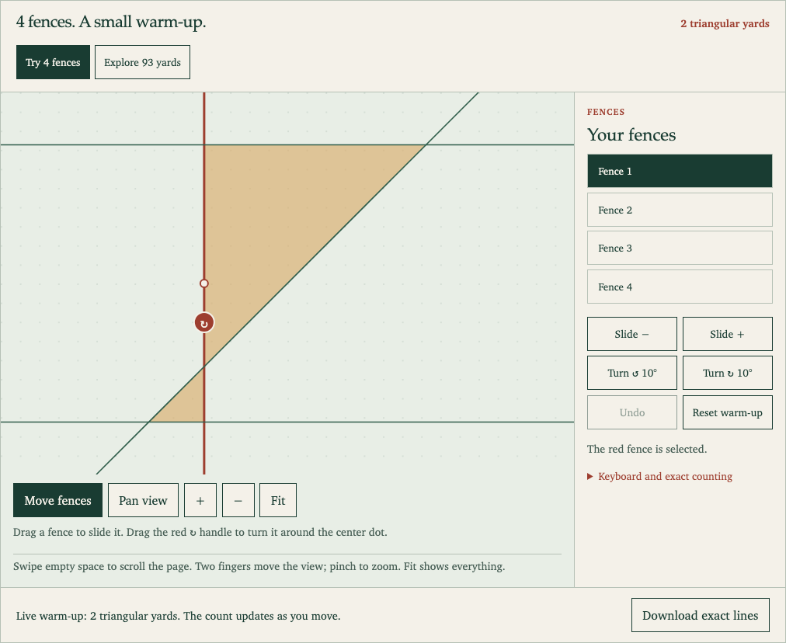
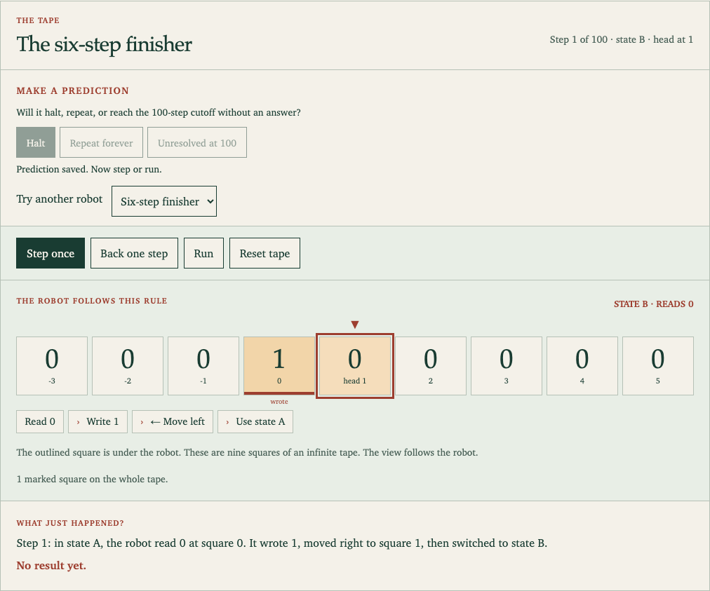

# Math You Can Touch

Explore two math puzzles by changing something and watching what happens. Both playgrounds run in your browser, with no account or installation.

## Play

### Move a fence

[](https://qsimeon.github.io/math-you-can-touch/fences.html)

Start with four fences. Drag a fence or its red turn handle to make yards appear and disappear. **[Open the fence playground](https://qsimeon.github.io/math-you-can-touch/fences.html).**

### Program a tiny robot

[](https://qsimeon.github.io/math-you-can-touch/beaver.html)

Make a prediction, press **Step once**, then change a rule and try again. **[Open the tape robot](https://qsimeon.github.io/math-you-can-touch/beaver.html).**

## A quick tour

Each fence is a straight line that continues beyond the board. Only triangles with no fence cutting through them count as yards. On a phone, drag a fence to edit it, swipe empty space to scroll the page, or use two fingers to pan and zoom. On a trackpad, scroll vertically through the page, scroll sideways to pan the board, or pinch to zoom. **Fit** restores the view. **Undo** reverses the last edit.

Choose **Explore 93 yards** to inspect Johannes Bader’s 18-fence construction. Select a shaded yard to highlight its three fences. The expandable saved-position lesson shows what happens when one fence moves.

The robot follows four rules on an endless tape of 0s and 1s. Step forward, step back, or run. It may stop, repeat forever, or reach the checker’s 100-step limit without an answer. Editing a rule starts a fresh run.

[The visual story](https://qsimeon.github.io/math-you-can-touch/) explains the puzzles. [Research notes](docs/RESEARCH.md) contain the experiments and their limits. The general 94-yard question remains open. The computer-checked exclusion covers only threefold-symmetric, pairwise-crossing drawings with no triple intersections and awaits mathematical review.

## Run offline

Download the repository and open `site/fences.html` or `site/beaver.html` with JavaScript enabled. Everything needed is included. If your browser restricts local files, run this from the repository root and open **http://127.0.0.1:8000**:

```sh
python3 -m http.server 8000 --bind 127.0.0.1 --directory site
```

## Run the checks

Python 3.10+ can recount the published drawing with two independent exact methods:

```sh
python3 -c "from kobon.verify import verify_file; r=verify_file('candidates/prior-art-93/solution.json'); print(r['score'], r['verification'])"
python3 -m unittest tests.test_public_site tests.test_segment_audit -v
```

The recount prints `93 two local exact-arithmetic algorithms agree`. [Full test commands and the code map](docs/RESEARCH.md#development-and-checks) include the optional browser, solver and straightening checks.

## Credits and reuse

The playground’s 93-yard drawing reconstructs Johannes Bader’s construction from Pavlo Savchuk’s [LineOrder drawing](candidates/prior-art-93/README.md), used under [CC BY 4.0](https://creativecommons.org/licenses/by/4.0/). We converted its coordinates to exact integer equations. It is not a new record or a proof of the maximum. The robot checks reproduce the known two-state result.

The upstream license covers its material. No license is granted here for the newly written code.
