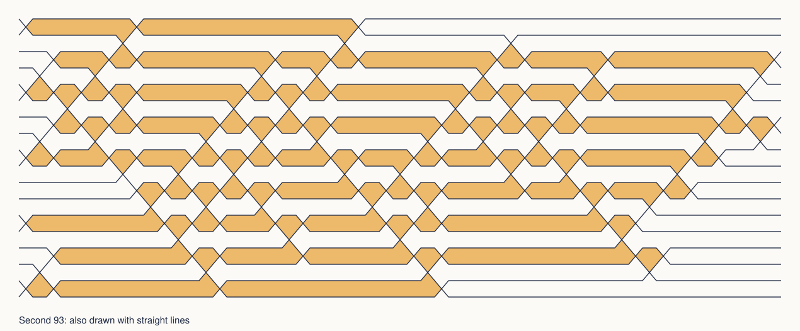

# Research notes

The playgrounds lead to two research questions. With 18 straight lines, can we make more than the 93 undivided triangular regions in Johannes Bader's known construction, or show that 93 is the most? With a two-state tape robot, can our own checker explain why every machine that has not halted by step 100 will never halt? The robot question has a checked answer, described at the end of this note. The line question remains open. A direct search of crossing patterns has narrowed it: no drawing with the threefold symmetry of Bader's 93 reaches 94, and the same search found a different 93 that can be drawn with straight lines.

## The 76-to-93 gap

Our first program started from random 18-line drawings. An ordinary proposal changed one integer coefficient on one line by 1, 2, 5 or 12. Some proposals replaced the whole line instead. The program accepted moves that maintained or raised the count, and unconditionally accepted a fresh random start every 200 proposals. The initial coefficients were small: normal components between -30 and 30 and offsets between -150 and 150. Three seeds ran for 1,200 proposals each, about 37 seconds per seed. They found 76, 73 and 73 triangular faces. The public repository includes the 76 drawing and its seed/step provenance, but its full proposal ledger stays in the separate research workspace.

Bader built his earlier 93-face arrangement independently of our program. His [archived page](https://www.sop.tik.ee.ethz.ch/people/baderj/other.html) calls the drawing threefold rotationally symmetric. We reconstructed an exact integer-coordinate drawing from Pavlo Savchuk's [LineOrder gallery SVG](https://raw.githubusercontent.com/zegalur/line-order/2631b8793eb351be2ad6b8a91b7194eeb67e25bb/gallery/imgs/kobon_18_93tri_lines.svg). Its largest coefficient magnitude is 736,030,939, well outside the small coefficients used to start our original random runs. Both exact counters find 93 faces in our reconstruction. We have not established equality with Bader's original coordinates or crossing order. Bader's archived page describes the drawing, but not how he discovered it. Savchuk's later algorithm offers a different research method.

To measure the structure of these drawings, count the bounded pieces into which intersections divide each line. Assume no three lines meet. Let `p` be the number of parallel pairs. If each line crosses at least one other line, the total number of such *segments* on 18 lines is `E = 288 - 2p`. An all-parallel drawing has no triangles and is handled separately. Every triangular face uses three segments, and a segment cannot border triangular faces on both sides when each vertex joins exactly two lines. Thus the count of unused segments is `U = E - 3T`, where `T` is the number of triangular faces. Both saved drawings satisfy these conditions:

| Exact drawing | Parallel pairs `p` | Bounded segments `E` | Triangular faces `T` | Unused segments `U` |
| --- | ---: | ---: | ---: | ---: |
| Our original search | 1 | 286 | 76 | 58 |
| Reconstructed Bader construction | 3 | 282 | 93 | 3 |

The three unused segments in the reconstruction lie on line indices 0, 7 and 12, each belonging to a parallel pair. Indices start at zero in the downloaded line list. Use the [segment-audit command](../README.md#run-the-checks) to see their endpoint crossings. This measures a difference between two checked arrangements. The next question is whether changing one crossing at a time can improve a high-scoring drawing. In the saved 41-position motion study, moving one line of the 93 arrangement produced scores from 80 to 93. Four later runs starting at 93 each made 1,500 proposals, mostly changing one coefficient. Their restarts made three line-parameter changes before checking a new drawing. No summary reports an improvement, and the public copy does not include the per-proposal logs.

## From crossing patterns to straight lines

Savchuk's [2025 paper](https://arxiv.org/html/2507.07951v1) describes a structural search. Record, for each line, the order in which other lines cross it. A *pseudoline* can bend while retaining this pattern, so first search crossing orders without choosing exact coordinates. The paper encodes conditions on the orders as a satisfiability problem and asks a SAT solver for candidate tables. Then it tries to *straighten* a candidate: find angles and offsets for actual lines whose crossings occur in the required order. The straightening step uses heuristic SciPy minimization over order inequalities. A failure to straighten a table does not prove that the table is impossible for straight lines. Any promising straight-line result still needs an exact face recount. This repository includes a satisfiability model of crossing patterns and its own straightener, both described in [Searching every crossing pattern](#searching-every-crossing-pattern).

Savchuk's published model already has optional variables for bounded segments without a neighboring triangle. It assumes every pair of lines crosses in a distinct point. A missing crossing for parallel lines needs a different encoding. He also [proposes extending the approach to even line counts and underused parallel/concurrent cases](https://arxiv.org/html/2507.07951v1). Adapting those ideas to 18 lines would build on this prior work.

## The upper bound of 94

Bartholdi, Blanc and Loisel's [published theorem](https://arxiv.org/html/0706.0723v1) gives a bound for *simple*, pairwise-intersecting arrangements of 18 lines, including pseudolines: `floor(18(18 - 7/3)/3) = 94`. [OEIS](https://oeis.org/A006066) lists 93 achieved and 94 as the reported upper bound for the 18-line problem. The theorem cannot be applied directly to our 93 drawing because three pairs of its lines are parallel. For a no-triple-point arrangement, a short perturbation argument suggests that rotating parallel lines by sufficiently small angles creates new crossings far away while leaving existing bounded triangular faces intact. This would extend that 94 ceiling to the no-triple-point case with parallel lines. This argument has not been formally checked or reviewed by a mathematician. Triple intersections need separate treatment.

The elementary segment count says that a hypothetical 94-face drawing with three parallel pairs would need `U = 282 - 3×94 = 0`. That is a necessary condition, not evidence that such a drawing exists. We have not established whether a drawing with parallel pairs can reach 94. The crossing-pattern search below covers drawings where every pair crosses, in which a 94 would leave exactly six unused segments. Parallel and concurrent arrangements remain open cases. A specialist must review any proposed parallel-pair exclusion before it can be used in a proof. Proving 93 is the maximum requires ruling out 94 across all permitted classes. A finite unsuccessful search does not establish that result.

## Shared vertices and the fan

Multiple distinct lines may cross at the same point. The verifier allows that vertex and rejects duplicate lines. To see why traced triangle outlines do not always count as regions, take the 17 lines `y = i x` for `i = 0, ..., 16` through the origin and add `x = 1`. Selecting two of the rays and the transversal gives `17 choose 2 = 136` triangle outlines. Only the 16 formed by neighboring rays are undivided triangular faces. Both exact checkers return 16. The fan has 33 bounded line segments. Its 16 triangles have 48 side incidences, so some bounded segments border two triangles. The `U = E - 3T` shortcut assumes this sharing cannot happen and does not apply to the fan. Each added ray divides an older triangle in two, so the count grows by one per ray.

Concurrency is a genuine possible tool, not an excluded case. [OEIS records a 14-line construction with 54 faces](https://oeis.org/A006066) that uses triple points. A rigorous 18-line upper bound would need to cover this legal class as well.

## Searching for 94 one crossing at a time

The included exact audit maps each of the three unused segments in the 93 drawing to its neighboring crossings. An arrangement with 94 faces and *every pair crossing* would leave exactly six of its 288 bounded segments unused. To get an all-crossing starting point, add 1 to the first coefficient of lines 1, 7 and 13 in the included 93 witness. Both counters still find 93 faces, and the segment audit finds nine unused segments. Eight ±1 versions of these three changes all stayed at 93. These are finite probes, not a search result above 93.

The wall-crossing search works on *straight-line drawings directly*. It starts from the all-crossing 93 witness produced by those three coefficient changes. A move holds one line's direction fixed and slides it just past the nearest crossing point of the other 17 lines, in either direction. In a drawing with no parallel lines and no triple points, that flips exactly one triangle: the moving line and the two lines through the crossed point each swap one neighboring pair in their crossing order. If several crossing points share the nearest offset, the move is rejected. The new offset is the simplest rational strictly between that crossing and the next one, which keeps coefficients small. Both exact checkers recount every drawing. The search expands the highest-scoring drawing first, keeps lower-scoring drawings so it can leave a local peak, and counts each crossing pattern once, identified by the order of crossings along every oriented line and the cyclic order of line directions. For example, sliding line 0 of the starting drawing to `[0, 2, -727]` crosses one point and gives 90 faces with 18 unused segments.

A pilot over 1,000 distinct crossing patterns found no 94, and neither did a follow-up over 20,000, which followed chains of up to 13 moves and never climbed back above 90. The starting 93 is a strict local peak for this move: all 24 of its distinct one-move neighbors have 90 faces. In every case the flipped triangle survives, the three triangles touching its corners become four-sided regions, and no new triangle appears. The 93 drawing packs its triangles corner to corner, so any single slide costs three faces. So any route from this drawing to 94 must pass through lower scores, take more than one move, or use a different move, such as rotating a line past a crossing point (which must also reject moves that make two lines parallel). These finite runs give no upper bound. The next section takes a different route: instead of moving from the 93, it searches every crossing pattern at once.

## Searching every crossing pattern

Every search above began from small coefficients or from the 93 itself, so it mostly confirmed what was expected. This search starts from nothing. It asks a SAT solver, a program that decides whether a list of true-or-false conditions can all hold at once, whether any crossing pattern of 18 lines has 94 triangles.

The search covers *pseudolines*. These are curves that each run from left to right, where every two cross exactly once and no three meet at a point. Straight lines are a special case, so if no pseudoline drawing has 94 triangles, no straight one does either. The search stores a drawing as one true-or-false fact for each triple of lines. With the lines numbered by slope, the fact for lines a < b < c says whether the crossing of a and c lies above b. Felsner and Weil showed that an assignment of these facts describes a drawing exactly when no four lines change their answer twice. Three lines bound a triangle when every other line keeps all three of its corners on one side. A separate checker recounts every drawing the solver returns, reading the triangles off the order in which each line meets the others.

The formula also states two facts that a solver cannot work out by itself. The first is a count. Each triangle touches three lines, and a line can touch at most *n* − 2 triangles, one along each of its bounded pieces. Call a line *full* when it does. For an even number of lines, Bartholdi, Blanc and Loisel showed that each full line forces an unused piece of some other line, and that no piece is forced by more than two full lines. For 18 lines and 94 triangles these facts leave no slack: exactly 12 lines touch 16 triangles, and the other 6 touch exactly 15. The second fact is that turning the plane renumbers the lines without changing the drawing, so the solver may assume that line 0 is full.

Before the 18-line run, the search was tested on 3 to 17 lines, where the answers are published, and every answer it gave was correct. It found the best known count for every size up to 15 lines. It also proved one more impossible for every size up to 11 lines, which includes Savchuk's result that 11 lines cannot make 33 triangles (about six minutes here). For 13, 15, 16 and 17 lines, the count alone rules out one more, and the search confirms this in under a tenth of a second. The two hardest cases, 12 lines with 38 triangles and 14 lines with 54, were still unresolved after 15 minutes.

**No threefold 94.** Bader's 93 looks the same after a turn by a third of a circle. Among drawings with that symmetry, the search found a 93 within seconds and then proved that none has 94. Four different solvers, using three ways of encoding the count, reached the same answer within 40 minutes. A standalone solver repeated the run while writing a 648 MB step-by-step proof, and an independent checker, drat-trim, verified that proof in 16 minutes. Therefore no threefold-symmetric drawing of 18 lines in which every pair crosses and no three meet has 94 triangles. In a symmetric drawing of straight lines, the turn moves triangles in groups of three, and only a triangle around the centre of the turn can stay in place. Since 94 = 3 × 31 + 1, a symmetric 94 would have needed exactly one central triangle. Neither paper this work builds on contains this result, and we have not searched the wider literature. It is a checked computation that no mathematician has yet reviewed.

**Two new 93s.** The 93s the solver returned differ from Bader's. A comparison tool checks every version of Bader's drawing that can be made by turning it, mirroring it, separating his three parallel pairs in 64 ways, or sending each of his lines to infinity in turn, and none matches. A second test ignores those choices. Adding the line at infinity as a nineteenth line and counting again gives 105 triangles for every version of Bader's drawing and 102 for the first solver 93, so that drawing differs from his even in the projective plane. A new straightener turned it into straight lines with every coefficient between −70 and 70 (`candidates/sat-93-a`), and both exact counters find 93 triangles. The straightener fixes the slopes and solves a linear program for the offsets, then fixes the offsets and solves for the slopes, and repeats until every crossing lies on the correct side. It then rounds to small integers and recounts exactly. Applied to Bader's own pattern, it redraws his 93 with every coefficient between −42 and 42 (`candidates/small-93`), where the reconstruction needed 736,030,939. The other solver 93 did not straighten in 480 attempts, so it remains a drawing with curves. We have not checked whether either new 93 appears elsewhere.



*The second 93 as a wiring diagram. Each line is a horizontal track, two lines swap tracks where they cross, and the 93 shaded cells are the triangles.*

**Any 94.** Without the symmetry restriction, five solver runs looked for a 94 for two hours each and gave no answer. A control run asking only for 93 also gave no answer, so the unrestricted solver cannot yet reach even the known level, and its silence says nothing about 94. A 94 must have exactly 12 full lines. Splitting the search by which 6 slope positions hold the other lines gives 561 cases, up to turning and mirroring, each smaller than the whole and each able to produce its own proof. Whether those cases are small enough to finish is the next question.

## Certificates for the remaining robots

For the tape robot, the [known result `S(2)=6`](https://oeis.org/A060843) matches the six-step machine our checker found. Of 20,736 fully labeled two-state rule tables, 9,784 halt within 100 steps and 5,040 come with a repeating-configuration proof. The 100-step simulator leaves the remaining 5,912 unresolved. Two further exact certificates explain all of them.

For 2,896 tables, no halting rule can ever be read. Start with the rule for state A on a blank square. Any state that a reachable rule moves to, and any symbol that a reachable rule writes, can occur later, so add every such combination and repeat until nothing changes. The result contains every rule the machine can ever use. If it contains no halting rule, the machine never halts.

The other 3,016 are *record cycles*. At two moments the head stands farther right (or farther left) than ever before, in the same state. Everything beyond a record is still blank. If the tape over every square the head visits between those moments matches the tape at the second moment, shifted by the distance the head moved, then the second stretch reads the same symbols as the first one, shifted along the tape. It ends at a new record in the same state and leaves the same matching pattern, so by induction the robot runs forever. Every record cycle appears by step 8.

The certificate checker re-simulates each machine and re-derives every condition. No halting table receives a certificate. Our checks therefore account for all 20,736 tables and confirm that six steps is the longest halting run. This reproduces the known value `S(2)=6` with checkable certificates. We have not tried them on three-state machines, whose established maximum is 21 steps under the same convention. A head that sweeps back and forth across a growing block would not be a record cycle, so that behavior would need a new kind of certificate. A longer simulation is not a nonhalting proof.

## Reproducing the counts

Run these commands from the repository root with Python 3.10+:

```sh
python3 tools/segment_audit.py candidates/best/solution.json
python3 tools/segment_audit.py candidates/prior-art-93/solution.json
python3 -m tools.wall_crossing_pilot --budget 1000 --out wall-crossing-run
python3 -m tools.beaver_certificates --out beaver-certificates
python3 -m unittest tests.test_segment_audit tests.test_wall_crossing tests.test_beaver_certificates tests.test_kobon_sat -v
python3 -m tools.compare_93 candidates/sat-93-a/solution.json
```

The SAT search and the straightener also need `python-sat`, `numpy` and `scipy` (for example `pip install python-sat numpy scipy`). Without them, the tests that use them are skipped. To find a threefold 93 and straighten it, and to write the threefold 94 formula for any solver:

```sh
python3 tools/kobon_sat.py one --n 18 --at-least 93 --structure --fold 3 --encoding totalizer --out sat-93.json
python3 -m tools.straighten sat-93.json --out sat-93-lines.json
python3 tools/kobon_sat.py cnf --n 18 --at-least 94 --structure --fold 3 --encoding totalizer --out threefold-94.cnf
```

With CaDiCaL and drat-trim installed, `cadical threefold-94.cnf proof.drat` followed by `drat-trim threefold-94.cnf proof.drat` repeats the checked proof.

The segment audit uses the two existing exact triangle counters and refuses the unused-segment formula at multiple intersections. The two search commands write their logs into a new directory and refuse to overwrite an existing one. The website does not call these tools, so it works offline without Python once downloaded.
